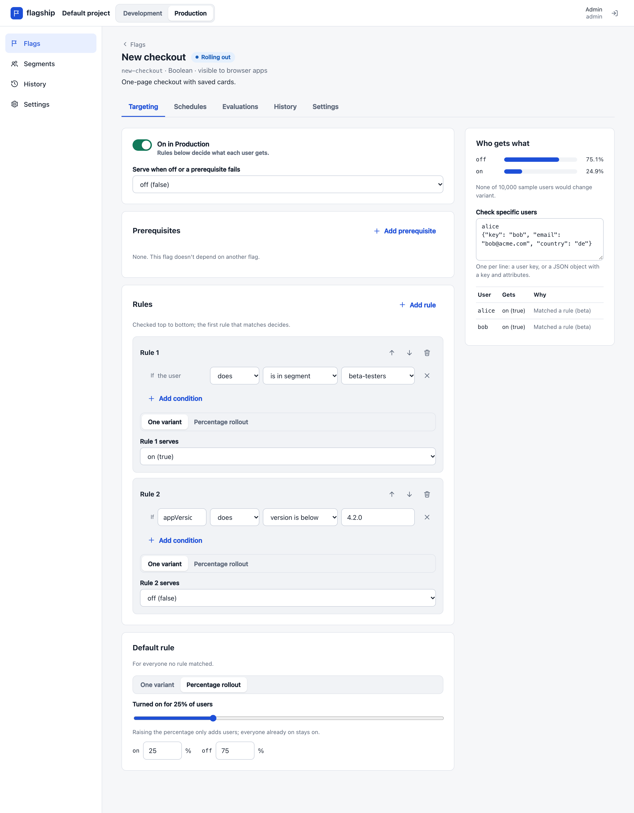
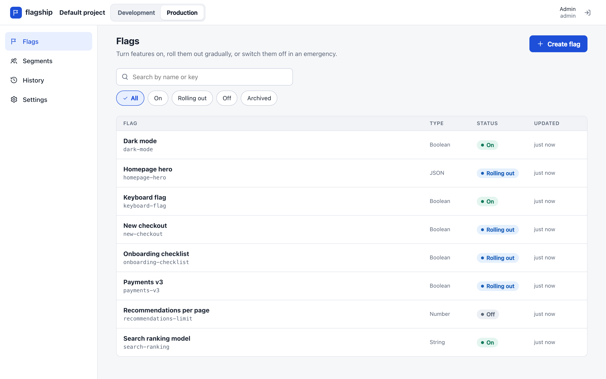
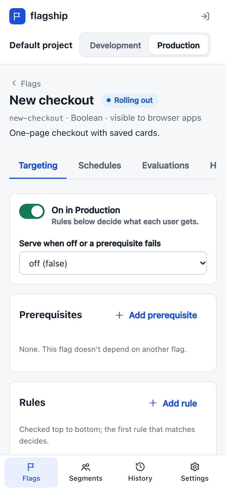

# flagship

A feature-flag and gradual-rollout service: you define flags and targeting rules in an
admin UI or API, and your apps evaluate them locally through an SDK that stays in sync
over Server-Sent Events. Rollouts are sticky, so growing one from 10% to 50% only ever
adds people, and a kill switch turns a feature off everywhere within milliseconds.

Written in TypeScript: a Fastify server on PostgreSQL, a React admin UI, a Node SDK with
an [OpenFeature](https://openfeature.dev) provider, and a browser SDK, all sharing one
evaluation package.

```ts
import { FlagshipClient } from '@flagship/node';

const flags = new FlagshipClient({
  sdkKey: process.env.FLAGSHIP_SDK_KEY!,
  baseUrl: 'https://flags.internal',
});
await flags.ready();

// A function call against the in-memory ruleset: no network, about half a microsecond.
if (
  flags.boolVariation(
    'new-checkout',
    { key: user.id, plan: user.plan, country: user.country },
    false,
  )
) {
  return renderNewCheckout();
}
```



## Flags, rules and rollouts

A flag has boolean, string, number or JSON variants and is configured separately in each
environment. Targeting rules look at attributes of the context: equality and lists, string
tests, number and semantic-version comparisons, and regular expressions. A linear-time engine
runs the patterns, so a bad one can't hang an SDK. Rules can also point at reusable segments,
which have include and exclude lists.

Percentage rollouts use consistent hashing. The same user gets the same variant on every
server, and raising the percentage never moves anyone out. You can bucket by user, or by any
attribute such as an organisation. Each flag also has a kill switch, prerequisites on other
flags (cycles are rejected), and scheduled changes that apply on time and exactly once, however
many server instances are running.

Server SDKs evaluate locally from a ruleset snapshot, kept current over SSE with resume
(`Last-Event-ID`) and ETag polling as a fallback. When the service is down, apps keep the last
ruleset or fall back to their own defaults. Browsers use client-side keys, which get evaluated
values only, never rules or other users.

Editing is versioned, and a stale edit gets `409`. The whole ruleset is validated before a
change commits, and the UI shows a diff and a live preview of who would change variant before
you save. An audit log records every change and who made it. Access uses three roles (viewer,
editor, admin) and cookie sessions with CSRF protection, and each environment has its own
server and client keys, stored hashed. SDKs also report which variants they served, batched
and with backpressure, and the UI shows the counts per variant.

## Running it locally

```console
$ docker compose up -d --build --wait     # Postgres + flagship on http://localhost:8080
$ ./examples/demo.sh                      # flag via the API, a Node app following it live
```

Sign in at <http://localhost:8080> as `admin@example.com` with the demo password from
`docker-compose.yml`. A fresh install has a `default` project with development and production
environments. Create a server key under Settings, then point an SDK at it.

The demo prints each step's evidence as the app receives it over SSE: 0/1000 users on, then
about 100 after a 10% rollout, then about 500 at 50% with every user from the 10% step still
on, then 0 after the kill switch. It fails if any step doesn't arrive within 15 seconds.

Working on flagship itself needs Node 22, pnpm and Docker.

```console
$ pnpm install
$ pnpm check            # format, lint, typecheck, tests with coverage (Postgres via Testcontainers)
$ pnpm e2e              # build, then Playwright + axe against the real server and UI
$ pnpm --filter @flagship/admin dev   # UI on :5173, proxying to a server on :8080
```

## SDKs

| Package                      | For         | How it works                                                                                                                                |
| ---------------------------- | ----------- | ------------------------------------------------------------------------------------------------------------------------------------------- |
| `@flagship/node`             | servers     | holds the ruleset, evaluates locally, SSE with resume, ETag polling fallback, exposure batching                                             |
| `@flagship/node/openfeature` | OpenFeature | `OpenFeature.setProvider(new FlagshipProvider({ sdkKey, baseUrl }))`                                                                        |
| `@flagship/browser`          | web apps    | client key; the server evaluates the user's context and the SDK caches the values for synchronous reads; refetches when the version changes |
| `@flagship/core`             | everything  | model, validation, evaluator; also used by the admin UI's preview                                                                           |

## HTTP API

Admin routes use the session cookie and need `X-CSRF-Token` on writes. SDK routes take
`Authorization: Bearer <key>`.

| Endpoint                                                                    | Purpose                                                       |
| --------------------------------------------------------------------------- | ------------------------------------------------------------- |
| `POST /api/session`, `GET /api/session`, `DELETE /api/session`              | sign in (returns the CSRF token), current user, sign out      |
| `PUT /api/session/password`                                                 | change password, ending other sessions                        |
| `GET/POST /api/users`, `PATCH /api/users/:id`                               | people and roles (admin)                                      |
| `GET/POST /api/projects`, `POST /api/projects/:p/environments`              | projects and environments                                     |
| `GET/POST/DELETE /api/projects/:p/environments/:e/api-keys[/:id]`           | SDK keys; the secret is returned once (admin)                 |
| `GET/POST /api/projects/:p/flags`                                           | list with `q`, `status`, `type` filters; create               |
| `GET/PUT /api/projects/:p/flags/:f`                                         | read; edit name, description, variants (with `version`)       |
| `PUT /api/projects/:p/flags/:f/environments/:e`                             | replace targeting (with `version`)                            |
| `POST /api/projects/:p/flags/:f/environments/:e/kill-switch`                | `{"enabled": false}`, no version needed                       |
| `POST /api/projects/:p/flags/:f/archive`, `/restore`                        | archive and restore                                           |
| `GET/POST/DELETE /api/projects/:p/flags/:f/environments/:e/schedules[/:id]` | scheduled changes                                             |
| `GET /api/projects/:p/flags/:f/exposures?environment=&hours=`               | per-variant counts                                            |
| `GET/POST/PUT/DELETE /api/projects/:p/environments/:e/segments[/:s]`        | segments (with `version`)                                     |
| `GET /api/projects/:p/environments/:e/ruleset`                              | the environment's ruleset, for tooling and the UI             |
| `GET /api/projects/:p/audit?flag=&segment=&before=`                         | change history with diffs                                     |
| `GET /sdk/v1/ruleset`                                                       | snapshot with ETag (server keys)                              |
| `GET /sdk/v1/stream`                                                        | SSE: `put`, then `patch` per change (server keys)             |
| `POST /sdk/v1/evaluate`                                                     | values for a context (client keys see client-side flags only) |
| `GET /sdk/v1/client-stream?key=`                                            | SSE of version numbers for browsers                           |
| `POST /sdk/v1/events`                                                       | exposure counts; `429` + `Retry-After` when the queue is full |
| `GET /healthz`, `GET /readyz`, `GET /metrics`                               | liveness, readiness (checks Postgres), Prometheus             |

Errors look like `{"error":{"code":"version_conflict","message":"...","request_id":"...","details":{...}}}`
with stable codes: `invalid_argument` 400 (with field paths in `details`), `unauthenticated` 401,
`permission_denied` 403, `not_found` 404, `already_exists` / `version_conflict` 409,
`payload_too_large` 413, `unsupported_media_type` 415, `resource_exhausted` 429,
`unavailable` 503.

## Testing

| What         | How                                                                                                                                                                                                                                                                                                                                                                                     |
| ------------ | --------------------------------------------------------------------------------------------------------------------------------------------------------------------------------------------------------------------------------------------------------------------------------------------------------------------------------------------------------------------------------------- |
| Evaluator    | A second, plainly written implementation agrees with it on 1,000 random valid rulesets and contexts. Deliberately broken evaluators (exclusion after inclusion, ignoring a disabled prerequisite, rollout ranges walked backwards, negation matching missing attributes) fail it.                                                                                                       |
| Bucketing    | MurmurHash3 checked against published vectors and a BigInt reference on random Unicode; property tests for stickiness as percentages grow and for distribution over 100k users.                                                                                                                                                                                                         |
| Regex engine | 5,000 random patterns compared with JavaScript's `RegExp`; catastrophic patterns on 1 KB inputs finish in microseconds.                                                                                                                                                                                                                                                                 |
| Conformance  | 5 JSON case files (every operator and reason, segments, prerequisites, pinned rollout buckets) run against the core evaluator, the Node SDK over HTTP, the server's evaluate endpoint, and the browser SDK against the real server.                                                                                                                                                     |
| Server       | Every route against a real Postgres 17 (Testcontainers): concurrent edits get one winner, two scheduler instances apply a change once, a stream resumes with exactly the missed patches, a change made on one instance reaches a stream on another, the listener recovers when its connection is killed, revoked keys lose their streams, and tokens and contexts never reach the logs. |
| SDKs         | The Node SDK against a stub server that dies mid-stream and comes back; against the real server for a 10% → 50% rollout and the kill switch; the OpenFeature provider through the OpenFeature SDK; the browser SDK in jsdom.                                                                                                                                                            |
| Admin UI     | Component tests with Testing Library; Playwright against the built server for the main journeys, a two-editor conflict, a keyboard-only run, and axe (no serious or critical WCAG 2.1 AA findings) on every page at 1440 and 390 px and in dark mode.                                                                                                                                   |
| Whole stack  | `examples/demo.sh` against the Docker image.                                                                                                                                                                                                                                                                                                                                            |

819 Vitest tests at 96.7% line coverage (the gate requires 90%), plus 7 Playwright tests.

## Benchmarks

On an Apple M4 Max with Node 22, local evaluation, with the context matching no rule (so
every clause is checked), takes:

| Case                                                | Time       |
| --------------------------------------------------- | ---------- |
| One flag, no rules                                  | 24 ns      |
| 5 rules × 3 clauses, 1k-member segment, 10% rollout | 0.54 µs    |
| 50 rules with regex, 2 prerequisites                | 45 µs      |
| All 200 typical flags for one browser request       | 114–147 µs |

Update latency, from the API call that makes a change to each connected SSE stream receiving
it, 20 changes per run, client threads on the same machine:

| Streams | p50     | p99     | max     |
| ------- | ------- | ------- | ------- |
| 1,000   | 15.3 ms | 23.2 ms | 24.5 ms |
| 10,000  | 53.8 ms | 78.0 ms | 81.3 ms |

`pnpm bench` and `pnpm bench:fanout` reproduce these.

## Admin screens

| Flags                                                                              | Flag on a phone                                                   |
| ---------------------------------------------------------------------------------- | ----------------------------------------------------------------- |
|  |  |

More in [docs/screenshots](docs/screenshots), all produced by the end-to-end run.

## Docs and source

[docs/DESIGN.md](docs/DESIGN.md) covers the data model, evaluation order, the bucketing
algorithm, why there is a regex engine, how streaming resumes and fans out across instances,
client-side evaluation, sessions and CSRF, scheduled changes, exposure backpressure, failure
modes, limits and what would change to scale further. The code is laid out like this:

```text
packages/core          ruleset model, validation, evaluator, bucketing, semver, regex engine, diff
packages/conformance   JSON cases every evaluator must pass, and the runner
packages/sdk-node      Node SDK and OpenFeature provider
packages/sdk-browser   browser SDK
apps/server            Fastify server: admin API, SDK endpoints, streaming hub, scheduler, exposures
apps/admin             React admin UI
e2e                    Playwright and axe tests
bench                  evaluation and fan-out benchmarks
examples               demo script and a small Node app
```
