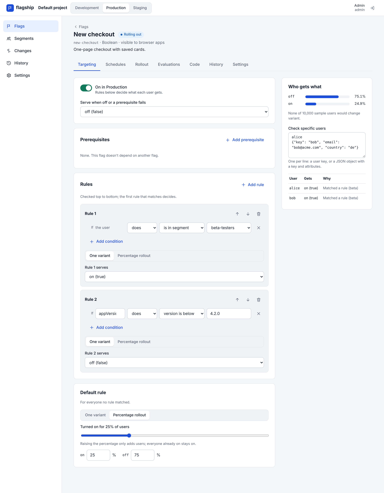
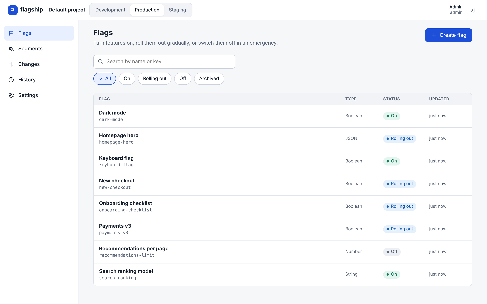
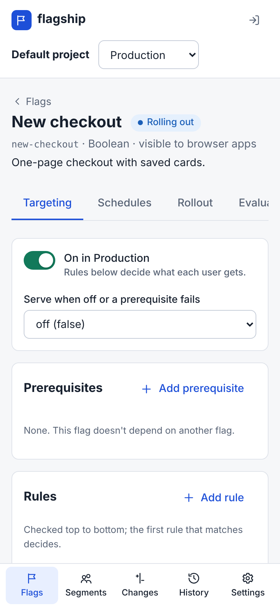

# flagship

A feature-flag and gradual-rollout service: you define flags and targeting rules in an
admin UI or API, and your apps evaluate them locally through an SDK that stays in sync
over Server-Sent Events. Rollouts are sticky, so growing one from 10% to 50% only ever
adds people, and a kill switch turns a feature off everywhere within milliseconds.

Written in TypeScript: a Fastify server on PostgreSQL, a React admin UI, a Node SDK with
an [OpenFeature](https://openfeature.dev) provider, and a browser SDK, all sharing one
evaluation package.

```ts
import { FlagshipClient } from '@flagship/node';

const flags = new FlagshipClient({
  sdkKey: process.env.FLAGSHIP_SDK_KEY!,
  baseUrl: 'https://flags.internal',
});
await flags.ready();

// A function call against the in-memory ruleset: no network, about half a microsecond.
if (
  flags.boolVariation(
    'new-checkout',
    { key: user.id, plan: user.plan, country: user.country },
    false,
  )
) {
  return renderNewCheckout();
}
```



## Flags, rules and rollouts

A flag has boolean, string, number or JSON variants and is configured separately in each
environment. Targeting rules look at attributes of the context: equality and lists, string
tests, number and semantic-version comparisons, and regular expressions. A linear-time engine
runs the patterns, so a bad one can't hang an SDK. Rules can also point at reusable segments,
which have include and exclude lists.

Percentage rollouts use consistent hashing. The same user gets the same variant on every
server, and raising the percentage never moves anyone out. You can bucket by user, or by any
attribute such as an organisation. Each flag also has a kill switch, prerequisites on other
flags (cycles are rejected), and scheduled changes that apply on time and exactly once, however
many server instances are running. A progressive rollout steps a variant from a small share to
everyone on its own (1%, 5%, 10%, 25%, 50%, 100% by default, each held as long as you choose),
each step exactly once across instances; turning the flag off pauses it, and nobody who has the
new variant loses it at a later step. Guard metrics on a plan (an error rate, say) are checked after
every hourly rollup: when the new variant is confidently worse than the baseline, the plan
pauses or rolls the serve back to the baseline, and the audit log keeps the numbers.

Server SDKs evaluate locally from a ruleset snapshot, kept current over SSE with resume
(`Last-Event-ID`) and ETag polling as a fallback. Every snapshot and every patch carries a
checksum of the whole ruleset; an SDK that ends up with something else, after a lost or
garbled patch, keeps its last good ruleset and fetches a fresh one. When the service is down,
apps keep the last ruleset or fall back to their own defaults. Browsers use client-side keys,
which get evaluated values only, never rules or other users, and those answers are
checksummed too.

Editing is versioned, and a stale edit gets `409`. A flag's metadata and its targeting in
each environment have separate versions, so editing development never conflicts with an edit
to production. The whole ruleset is validated before a
change commits, and the UI shows a diff and a live preview of who would change variant before
you save. An audit log records every change and who made it. Access uses three roles (viewer,
editor, admin) and cookie sessions with CSRF protection, and each environment has its own
server and client keys, stored hashed. Failed sign-ins are limited per email and per address
from one budget in Postgres, so adding instances doesn't add guesses, and if that budget
can't be checked, sign-in answers `503` rather than letting the attempt through. SDKs also
report which variants they served, batched and with backpressure, and the UI shows the counts
per variant. For experiments, `track('purchase', context, 25)` records a conversion, and
SDKs report each context's first exposure to a percentage split once, so a conversion counts
for the variant that context saw first. Every instance rolls these up per variant and hour
of first exposure within about a minute, recomputing each hour from the raw events so
instances always agree. An experiment reads one flag's split against a control variant and
reports, per metric and variant, the conversion rate or mean count or value with a 95%
interval, and the difference and lift over the control with Welch's p-value. A sample ratio
check runs first; when the split doesn't match the weights (chi-square p < 0.001) the
results are hidden behind a warning.

A whole project exports to one JSON document (flags, targeting in every environment and
segments, with each environment's checksum) and imports back into a new project, or a copy
under another key. The import checks everything before it writes anything, and the copy serves
rulesets with the same checksums as the original.

## Running it locally

```console
$ docker compose up -d --build --wait     # Postgres + flagship on http://localhost:8080
$ ./examples/demo.sh                      # two instances, a Node app following a flag live
```

Sign in at <http://localhost:8080> as `admin@example.com` with the demo password from
`docker-compose.yml`. A fresh install has a `default` project with development and production
environments. Create a server key under Settings, then point an SDK at it.

The demo starts a second instance on <http://localhost:8081> (the compose profile `multi`),
makes every change through the first and runs a small Node app on the second, then prints
each step's evidence as it checks it:

- ten wrong passwords for one email, alternating between the instances, get `401`; the next
  attempt gets `429` from both;
- the app sees 0/1000 users on, then about 100 after a 10% rollout;
- development and production are saved from one load of the flag without a conflict, and a
  second save with the same production version gets `409`;
- at 50% about 500 users are on, and every user from the 10% step is still on;
- the app, the first instance and the second report the same ruleset checksum;
- the second instance is SIGKILLed, the kill switch is saved on the first, and when the
  second starts again the app reconnects, resumes and serves 0/1000, on the same checksum;
- the project is exported, imported under a new key, and the copy's checksums match;
- an incident drill on a protected production (one approval, a reason and a ticket link
  required): a direct edit gets `403`; a second user's change request turns the flag on for
  everyone, its author's own approval gets `403` and an unapproved apply `409`, and once an
  admin approves and it is applied the app serves 1000/1000; History search by text, actor
  and time finds the applied change; restoring it opens a change request the restorer can't
  approve, and once the other user approves it the app is back at 0/1000 on the same checksum
  as both instances. Production is unprotected again at the end, and a run that stopped
  half-way through the drill is cleaned up by the next one;
- two experiments on new 50/50 flags in production, fed through the Node SDK on the second
  instance and read on the first. In one, exactly 10% of 4,000 shoppers buy under `off` and
  15% under `on`: the results show exactly those counts and rates with their intervals, a lift
  near +50% whose interval excludes zero, and the revenue per shopper. In the other, a second
  client decides the variant without reporting it, and one in five visitors served `on`
  leaves before the reporting client sees them: the sample ratio check fails (chi-square
  about 44, p far below 0.001) and the metrics are hidden behind the warning unless
  `?showMismatched=true`.
- a webhook for every production flag change, sent to a receiver on the Docker host
  (`examples/node-app/receiver.mjs`) that checks each request with `parseWebhook()` from the
  Node SDK: the secret is shown once, the kill switch on a new flag is verified about 0.2 s
  after it is saved, a request with a made-up signature or none gets `401`, the delivery log
  shows the attempt and its `204`, and a replay arrives with a new delivery id and the same
  event id, which the receiver recognises and doesn't act on twice;
- a guarded rollout of that flag at 20% with a rollback guard on `checkout-error` (25%
  tolerance). A checkout app (`examples/node-app/checkout.mjs`) sends 3,000 checkouts through
  the SDK on the second instance; exactly 10% fail on the new path and 1% on the old. Within
  seconds of the next rollup the guard rolls the plan back: the plan reads `rolled_back` with
  the breached readings (a typical run: 10.0% of about 600 against 1.0% of about 2,400, lift
  about +900% with a 99% interval near [+290%, +1580%]), the app serves 0/3000 on the new
  path, History shows `flag.rollout.rollback` and `flag.rollout.guard` by the guard, the
  receiver verifies both events, and a new plan can start on the flag.

It fails if any check doesn't hold or the app doesn't print a step in time (15 seconds, 60
for the restart, 90 for experiment results and the guard's rollback, 30 for a webhook). The
compose stack rolls experiment results up every 5 seconds rather than every minute, so they
are ready right after the events are sent. It also sets a demo-only `FLAGSHIP_SECRET_KEY`
for webhook secrets, and maps `host.docker.internal` to the Docker host and allow-lists it in
`FLAGSHIP_WEBHOOK_ALLOWED_TARGETS`, since webhooks refuse private addresses otherwise. The
receiver listens on port 9090 (`FLAGSHIP_RECEIVER_PORT`).
Like any p < 0.001 check, the fair split's sample ratio check fails about one run in a
thousand by chance. Stop the stack with `docker compose --profile multi down -v`.

Working on flagship itself needs Node 22, pnpm and Docker.

```console
$ pnpm install
$ pnpm check            # format, lint, typecheck, tests with coverage (Postgres via Testcontainers)
$ pnpm e2e              # build, then Playwright + axe against the real server and UI
$ pnpm --filter @flagship/admin dev   # UI on :5173, proxying to a server on :8080
```

## SDKs

| Package                      | For         | How it works                                                                                                                                                         |
| ---------------------------- | ----------- | -------------------------------------------------------------------------------------------------------------------------------------------------------------------- |
| `@flagship/node`             | servers     | holds the ruleset, evaluates locally, SSE with resume, ETag polling fallback, exposure and `track()` batching; `parseWebhook()` checks a webhook's signature and age |
| `@flagship/node/openfeature` | OpenFeature | `OpenFeature.setProvider(new FlagshipProvider({ sdkKey, baseUrl }))`                                                                                                 |
| `@flagship/browser`          | web apps    | client key; the server evaluates the user's context and the SDK caches the values for synchronous reads; refetches when the version changes                          |
| `@flagship/core`             | everything  | model, validation, evaluator; also used by the admin UI's preview                                                                                                    |
| `@flagship/admin-client`     | tooling     | the admin API over `fetch`, one typed method per operation, generated from `GET /api/openapi.json`; errors are `AdminApiError` with the server's code                |
| `@flagship/cli`              | terminals   | the `flagship` command: profiles, flags, segments, change requests, `eval` with a trace, `export`; `--json` everywhere                                               |

## Command line

`@flagship/cli` installs a `flagship` command (Node 22.12 or later) over the admin API. Every
command takes `--json` for machine-readable output, with errors as JSON on stderr; the exit
status is 0, 1 when the server or the command failed, and 2 for bad arguments.

```console
$ flagship login --server https://flags.internal --email me@example.com -p shop -e production
Password for me@example.com:
$ flagship flag list
$ flagship flag off new-checkout --reason 'error rate alarm' --link https://tickets/42
$ flagship flag get new-checkout -e production --json | jq .environments.production > t.json
$ flagship cr propose flag new-checkout --file t.json --title 'Roll out to 25%'
$ flagship eval new-checkout --key user-1 --attr country=gb --attr plan=pro
new-checkout = true (variant on, TARGETING_MATCH by rule uk-pro)
  in shop/production for {"country":"gb","plan":"pro","key":"user-1"}

  1. kill switch: on
  2. rule uk-pro: matched, serves on
      yes  country in "gb", "ie"
      yes  plan equals "pro"
```

`login` saves a session (or, with `--token-stdin`, an API token) in a profile in
`~/.config/flagship/config.json`, written with mode 0600; the CLI refuses to read the file if
other users can. `--profile`, `flagship profile use` and `flagship profile set` switch between
servers and set a default project and environment. In CI, `FLAGSHIP_TOKEN`, `FLAGSHIP_SERVER`,
`FLAGSHIP_PROJECT` and `FLAGSHIP_ENVIRONMENT` work without any config file. There are commands
for flags (`list`, `get`, `create`, `update`, `on`, `off`, `target`, `archive`, `restore`),
segments (`list`, `get`, `create`, `update`, `delete`), change requests (`cr list`, `get`,
`propose`, `approve`, `request-changes`, `comment`, `apply`, `rebase`, `close`), `eval` and
`export`. Edits send the version just read, or the one given with `--if-version`, so a
concurrent change gets `409` instead of being overwritten. `eval` fetches the ruleset (or reads
a saved one with `--ruleset`) and evaluates it locally with `@flagship/core`, showing each rule
tried, each clause's result and the bucket of a split. `flagship <command> --help` lists the
options.

## HTTP API

Admin routes use the session cookie and need `X-CSRF-Token` on writes, or an API token in
`Authorization: Bearer fst_...` with no cookie or CSRF token. A token acts as the user who made
it, limited to its scopes, to one project or all, and optionally to some of that project's
environments; it expires after 1 to 365 days and can't manage sessions, users or tokens. Any
write can carry `Flagship-Reason` (percent-encoded) and `Flagship-Link` headers, recorded on its
audit entry. SDK routes take `Authorization: Bearer <key>`.

```sh
curl -X POST "$FLAGSHIP/api/projects/default/flags/new-checkout/environments/production/kill-switch" \
  -H "Authorization: Bearer $FLAGSHIP_TOKEN" -H 'Content-Type: application/json' \
  -H 'Flagship-Reason: error%20rate%20alarm' -d '{"enabled": true}'
```

The contract is `GET /api/openapi.json`, an OpenAPI 3.1 document built from the Zod schemas the
routes validate with; a route that doesn't declare its operation fails to register, and a copy
is committed at `packages/admin-client/openapi.json`. After changing a route, run `pnpm openapi`
to refresh it and the generated client; `pnpm test` fails until you do.

```ts
import { AdminClient } from '@flagship/admin-client';

const api = new AdminClient({ baseUrl: process.env.FLAGSHIP!, token: process.env.FLAGSHIP_TOKEN });
await api.setKillSwitch({
  path: { project: 'default', flag: 'new-checkout', environment: 'production' },
  body: { enabled: false },
});
```

Scopes: `flags`, `segments`, `change-requests` and `experiments` each `:read` and `:write`;
`audit:read`, `audit:restore`; `projects`, `sdk-keys` and `webhooks` each `:read` and `:write`.

| Endpoint                                                                    | Purpose                                                                                      |
| --------------------------------------------------------------------------- | -------------------------------------------------------------------------------------------- |
| `POST /api/session`, `GET /api/session`, `DELETE /api/session`              | sign in (returns the CSRF token), current user, sign out                                     |
| `PUT /api/session/password`                                                 | change password, ending other sessions                                                       |
| `GET/POST /api/users`, `PATCH /api/users/:id`                               | people and roles (admin)                                                                     |
| `GET/POST /api/tokens`, `DELETE /api/tokens/:id`                            | your API tokens; the secret is returned once (an admin can revoke anyone's)                  |
| `GET/POST /api/projects`, `POST /api/projects/:p/environments`              | projects and environments                                                                    |
| `GET/POST/DELETE /api/projects/:p/environments/:e/api-keys[/:id]`           | SDK keys; the secret is returned once (admin)                                                |
| `GET /api/projects/:p/export`                                               | the whole project as one JSON document, streamed (admin)                                     |
| `POST /api/projects/import?key=&name=`                                      | create a project from an export, validated first (admin)                                     |
| `GET/POST /api/projects/:p/flags`                                           | list with `q`, `status`, `type` filters; create                                              |
| `GET/PUT /api/projects/:p/flags/:f`                                         | read; edit name, description, variants (with `version`)                                      |
| `PUT /api/projects/:p/flags/:f/environments/:e`                             | replace targeting (with that environment's `version`)                                        |
| `POST /api/projects/:p/flags/:f/environments/:e/kill-switch`                | `{"enabled": false}`, no version needed                                                      |
| `POST /api/projects/:p/flags/:f/archive`, `/restore`                        | archive and restore                                                                          |
| `GET/POST/DELETE /api/projects/:p/flags/:f/environments/:e/schedules[/:id]` | scheduled changes                                                                            |
| `GET/POST /api/projects/:p/flags/:f/environments/:e/rollout-plans`          | progressive rollouts; start applies the first step                                           |
| `POST .../rollout-plans/:id/pause`, `/resume`, `/cancel`                    | pause, resume (restarts the step's hold) or cancel a rollout                                 |
| `GET .../rollout-plans/:id/guards`                                          | what each guard metric reads now: both means, the lift with its 99% interval, the state      |
| `GET /api/projects/:p/flags/:f/exposures?environment=&hours=`               | per-variant counts                                                                           |
| `GET/POST /api/projects/:p/experiments?environment=&flag=&status=`          | experiments; start one on a flag's live split, with a control and metrics                    |
| `GET /api/projects/:p/experiments/:x`, `POST .../experiments/:x/stop`       | read or stop an experiment                                                                   |
| `GET /api/projects/:p/experiments/:x/results?showMismatched=`               | per-variant rates, intervals and lift; hidden behind a warning on a failed SRM check         |
| `GET/POST/PUT/DELETE /api/projects/:p/environments/:e/segments[/:s]`        | segments (with `version`)                                                                    |
| `GET /api/projects/:p/environments/:e/ruleset`                              | the environment's ruleset, for tooling and the UI                                            |
| `GET /api/projects/:p/audit?flag=&segment=&actor=&q=&from=&to=&cursor=`     | change history with diffs, searchable, keyset-paged                                          |
| `GET /api/projects/:p/audit/:id/restore?to=before\|after`                   | what restoring an entry would change, against what is live                                   |
| `POST /api/projects/:p/audit/:id/restore`                                   | restore it, or open a change request in a protected env                                      |
| `PUT /api/projects/:p/environments/:e/change-notes`                         | require a reason and/or ticket link on every change (admin)                                  |
| `GET/POST/PATCH/DELETE /api/projects/:p/webhooks[/:id]`                     | signed webhooks for change events; the secret is shown once (admin, needs a secret key)      |
| `POST /api/projects/:p/webhooks/:id/secret`                                 | rotate the signing secret; the old one also signs for 24 hours (admin)                       |
| `GET /api/projects/:p/webhooks/:id/deliveries?status=&event=&cursor=`       | the delivery log, newest first, keyset-paged (admin)                                         |
| `GET /api/projects/:p/webhooks/:id/deliveries/:d`                           | one delivery with its payload and every attempt (admin)                                      |
| `POST .../deliveries/:d/replay, POST .../webhooks/:id/replay`               | send one finished delivery again, or every one in a window not yet replayed (admin)          |
| `GET /sdk/v1/ruleset`                                                       | snapshot with ETag and `checksum` (server keys)                                              |
| `GET /sdk/v1/stream`                                                        | SSE: `put`, then `patch` per change, each with `checksum`                                    |
| `POST /sdk/v1/evaluate`                                                     | values for a context (client keys see client-side flags only)                                |
| `GET /sdk/v1/client-stream?key=`                                            | SSE of version numbers for browsers                                                          |
| `POST /sdk/v1/events`                                                       | exposure counts, first exposures and conversions; `429` + `Retry-After` when a queue is full |
| `GET /healthz`, `GET /readyz`, `GET /metrics`                               | liveness, readiness (checks Postgres), Prometheus                                            |

Errors look like `{"error":{"code":"version_conflict","message":"...","request_id":"...","details":{...}}}`
with stable codes: `invalid_argument` 400 (with field paths in `details`), `unauthenticated` 401,
`permission_denied` 403, `not_found` 404, `already_exists` / `version_conflict` 409,
`payload_too_large` 413, `unsupported_media_type` 415, `resource_exhausted` 429,
`unavailable` 503.

## Testing

| What         | How                                                                                                                                                                                                                                                                                                                                                                                                                                                                                                                                                                                                   |
| ------------ | ----------------------------------------------------------------------------------------------------------------------------------------------------------------------------------------------------------------------------------------------------------------------------------------------------------------------------------------------------------------------------------------------------------------------------------------------------------------------------------------------------------------------------------------------------------------------------------------------------- |
| Evaluator    | A second, plainly written implementation agrees with it on 1,000 random valid rulesets and contexts. Deliberately broken evaluators (exclusion after inclusion, ignoring a disabled prerequisite, rollout ranges walked backwards, negation matching missing attributes) fail it.                                                                                                                                                                                                                                                                                                                     |
| Bucketing    | MurmurHash3 checked against published vectors and a BigInt reference on random Unicode; property tests for stickiness as percentages grow and for distribution over 100k users.                                                                                                                                                                                                                                                                                                                                                                                                                       |
| Regex engine | 5,000 random patterns compared with JavaScript's `RegExp`; catastrophic patterns on 1 KB inputs finish in microseconds.                                                                                                                                                                                                                                                                                                                                                                                                                                                                               |
| Conformance  | 6 JSON case files (every operator and reason, segments, prerequisites, pinned rollout buckets, checksums of a ruleset and four patches, canonical JSON vectors) run against the core evaluator, the Node SDK over HTTP, the server's evaluate endpoint, and the browser SDK against the real server.                                                                                                                                                                                                                                                                                                  |
| Server       | Every route against a real Postgres 17 (Testcontainers): concurrent edits get one winner, two scheduler instances apply a change once, a stream resumes with exactly the missed patches, a project exported and imported again serves rulesets with the same checksums, a change made on one instance reaches a stream on another, the listener recovers when its connection is killed, revoked keys lose their streams, and tokens and contexts never reach the logs.                                                                                                                                |
| Faults       | Two real server processes behind a TCP load balancer with 40 SDK clients evaluating through it: pooled Postgres connections killed, LISTEN sessions killed and an instance SIGKILLed, each followed at once by a kill-switch change. Every SDK serves the change within about a second, no evaluation falls back to a default, and every SDK ends on the server's checksum.                                                                                                                                                                                                                           |
| SDKs         | The Node SDK against a stub server that dies mid-stream and comes back, loses a patch or sends a bad checksum; against the real server for a 10% → 50% rollout, the kill switch and a corrupted stored patch it resyncs past; the OpenFeature provider through the OpenFeature SDK; the browser SDK in jsdom.                                                                                                                                                                                                                                                                                         |
| Experiments  | A property test drives random rollout plans through three racing instances with the kill switch thrown at random, against a model of every step; a model-based property sends exposures and conversions around the attribution window's edges, with retries, in random order and batches across two instances and two rollup workers, and compares the results route with a direct computation; the sample ratio check passes fair splits of 20,000 real evaluations and catches lost or misreported exposures and a rollout that stepped mid-experiment.                                             |
| Admin UI     | Component tests with Testing Library; Playwright against the built server for the main journeys, a two-editor conflict, a keyboard-only run, and axe (no serious or critical WCAG 2.1 AA findings) on every page at 1440 and 390 px and in dark mode.                                                                                                                                                                                                                                                                                                                                                 |
| Whole stack  | `examples/demo.sh` against two containers of the Docker image: the shared sign-in budget, per-environment versions, checksums on both instances, an instance killed and restarted, an export imported as a copy, an incident drill (a bad change through a change request, found by search, restored through another), two seeded experiments, one with a known +50% effect and one with a known sample ratio mismatch, checked against the results route, a webhook receiver verifying signatures, refusing forgeries and recognising a replay, and a guarded rollout rolled back by its error rate. |

1529 Vitest tests at 97.7% line coverage (the gate requires 90%), plus 8 Playwright tests.

## Benchmarks

On an Apple M4 Max with Node 22, local evaluation, with the context matching no rule (so
every clause is checked), takes:

| Case                                                | Time       |
| --------------------------------------------------- | ---------- |
| One flag, no rules                                  | 24 ns      |
| 5 rules × 3 clauses, 1k-member segment, 10% rollout | 0.54 µs    |
| 50 rules with regex, 2 prerequisites                | 45 µs      |
| All 200 typical flags for one browser request       | 114–147 µs |

Update latency, from the API call that makes a change to each connected SSE stream receiving
it, 20 changes per run, client threads on the same machine:

| Streams | p50     | p99     | max     |
| ------- | ------- | ------- | ------- |
| 1,000   | 15.3 ms | 23.2 ms | 24.5 ms |
| 10,000  | 53.8 ms | 78.0 ms | 81.3 ms |

Recovery, from injecting a fault to each step, with two instances behind a load balancer and
40 SDKs evaluating through it; 10 rounds per fault on a 4-vCPU Xeon with Node 22 and
PostgreSQL 17, median / p95 in ms:

| Fault                                          | First accepted write | Every SDK serves the change | Every SDK ready again |
| ---------------------------------------------- | -------------------- | --------------------------- | --------------------- |
| None (baseline)                                | 42 / 154             | 42 / 157                    | never stale           |
| Every pooled Postgres connection cut           | 52 / 151             | 103 / 165                   | never stale           |
| Both LISTEN sessions cut                       | 28 / 45              | 1,015 / 1,043               | never stale           |
| One instance SIGKILLed (41–67 connections cut) | 84 / 204             | 1,038 / 1,067               | 1,003 / 1,038         |

No evaluation fell back to a default in any round. A lost LISTEN session costs the
listener's 1 s reconnect delay, and a killed instance the SDK's 0.5–1 s jittered first
reconnect.

`pnpm bench:audit` seeds 1,000,000 audit entries and times search by flag, actor, text and
dates: every query's p95 is under 3 ms against a 50 ms budget
([`bench/results/audit.json`](bench/results/audit.json)).

`pnpm bench` and `pnpm bench:fanout` reproduce the first two tables. `pnpm bench:faults` runs
the fault suite with 10 rounds per fault and writes recovery times to
[`bench/results/faults.json`](bench/results/faults.json); a nightly CI job runs it too and
keeps the JSON as an artifact.

## Admin screens

| Flags                                                                              | Flag on a phone                                                   |
| ---------------------------------------------------------------------------------- | ----------------------------------------------------------------- |
|  |  |

More in [docs/screenshots](docs/screenshots), all produced by the end-to-end run.

## Docs and source

[docs/DESIGN.md](docs/DESIGN.md) covers the data model, evaluation order, the bucketing
algorithm, why there is a regex engine, how streaming resumes and fans out across instances,
client-side evaluation, sessions and CSRF, scheduled changes, exposure backpressure, failure
modes, limits and what would change to scale further. The code is laid out like this:

```text
packages/core          ruleset model, validation, evaluator, bucketing, semver, regex engine, diff
packages/conformance   JSON cases every evaluator must pass, and the runner
packages/stats         distributions, Welch's t-test, delta-method lift and the sample ratio check
packages/sdk-node      Node SDK and OpenFeature provider
packages/sdk-browser   browser SDK
packages/admin-client  typed admin API client, generated from the OpenAPI document
packages/cli           the flagship command line
apps/server            Fastify server: admin API, SDK endpoints, streaming hub, scheduler, exposures
apps/admin             React admin UI
e2e                    Playwright and axe tests
bench                  evaluation, fan-out, fault and audit search benchmarks
examples               demo script, small Node apps and a webhook receiver
```
